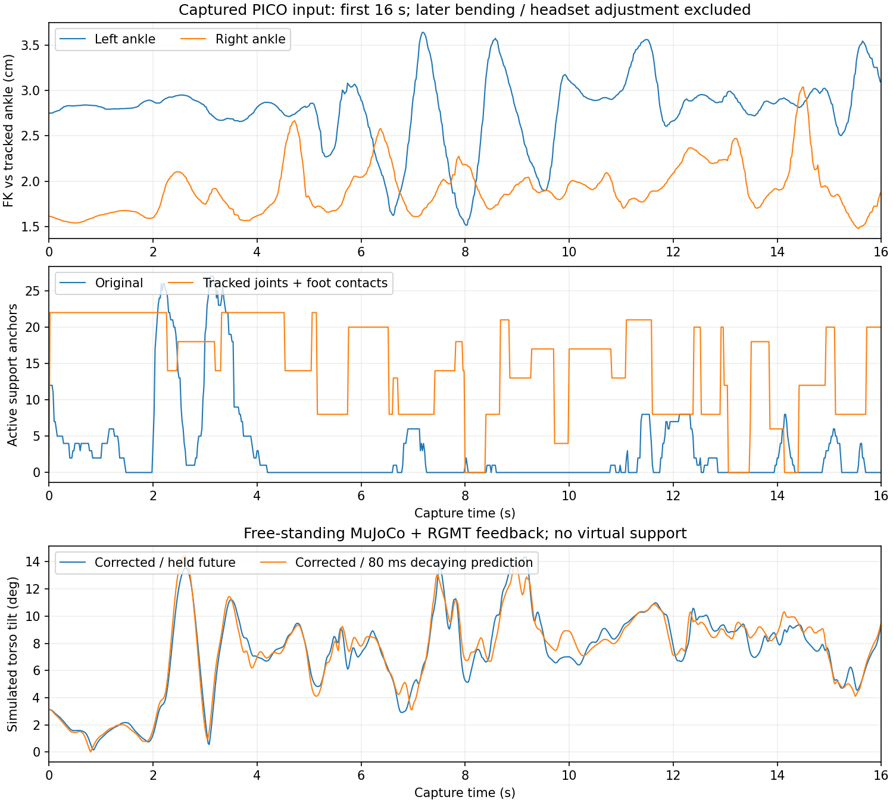

# PICO UMR 打滑诊断与修正记录

本次是实际佩戴 PICO 的人体输入采集；用户报告的问题发生在 MuJoCo 仿真。
采集期间控制节点未运行，因此没有录到当时机器人实际轨迹。下面的机器人动力学
结果来自同一人体输入的离线 MuJoCo + RGMT + PD 反馈回放，不能直接代表用户现场效果。

采集共 1474 帧、29.459 秒，频率 50.001 Hz，采样间隔 P99 20.61 ms。
SDK 总时间戳全部为零，诊断采用本机单调时钟；发送端对零 SDK 时间戳采用姿态变化
检测，不把重复数据当新帧。SDK 地面原点不是零高度，初始踝部高度约为 -1.51 m。

用户确认约 16 秒后确实弯腰或调整头显，该段身体前倾约 70° 不能判作坐标系错误。
以下参考和自由站立对照只采用前 16 秒（801 帧）。采集前给出的动作顺序为静站、
交替抬脚、前后走动，但没有逐段人工标注；这 16 秒不能当作完整的直线行走验证。

## 确认的问题与改动

原实时蒙皮由 neutral 骨架和节点转动重建脚位置，只采用实测骨盆位置。
统一人体尺度后，整段采集的左/右踝部重建误差均值为 2.76/1.94 cm，P95 为 3.25/2.30 cm。
现已将 22 个实测关节中心传入蒙皮，同时保留转动及 SMPL 姿态修正。

原接触锚点依赖重建表面落在 5 mm 地面带内。整段录制中足部表面最低高度中位数
约 1.12 cm，74% 的帧没有锚点。现在按实测踝/脚尖的相对地面高度和速度判断接触，
带速度滤波、两帧迟滞；支撑期固定底部锚点，抬脚后释放。实时锚点行权重为 15。
文件输入保留原接触逻辑和权重 5。

下表记录第一次实测位置/接触修正（5 cm 进入、8 cm 退出），并非后续的小步修正结果。
支撑状态采用同一套人体接触判定作为比较代理，没有外部力板或人工真值。
“没有锚点”包括真正的腾空帧，所以修正后并不要求其比例为零。

| 前 16 秒参考指标 | 原实时适配 | 实测位置 + 接触修正 |
| --- | ---: | ---: |
| 整帧没有锚点 | 57.43% | 6.99% |
| 推断支撑时，该脚没有锚点 | 65.26% | 0% |
| 推断支撑期踝部水平速度均值 | 11.84 cm/s | 6.16 cm/s |
| 同一速度 P95 | 30.17 cm/s | 16.44 cm/s |

参考脚平均横向运动降低约 48%。这描述运动学参考，不能与动力学接触点滑移混用。
锚点仍是软目标；接触判定也会受追踪漂移及启动时脚的位置影响，启动/恢复应先静站。

## 未来窗口对照

原实时窗口的后 10 帧重复当前姿态、速度置零。当前模型训练需要过去/未来各
200 ms 的参考，保持未来会改变训练时的动态提示。新增只使用过去和当前数据的
有限外推，默认指数衰减时间常数 80 ms，不等待未来帧。未来关节偏移限制 0.2 rad，
机身旋转限制 0.1 rad，并满足机器人关节限位。暂停及首帧保持；配置设为 0 可对照。

使用修正后相同的参考，完整机器人 XML、重力和地面接触，50 Hz RGMT 反馈及
500 Hz PD/MuJoCo 子步，先以第一参考静站 2 秒。没有虚拟根节点支撑。
表中的接触点速度由实际足部—地面接触点雅可比与仿真速度计算，不是人体接触代理。

| 前 16 秒自由站立回放 | 保持未来 | 80 ms 衰减外推 | 已知真实未来帧，仅作对照 |
| --- | ---: | ---: | ---: |
| 接触点水平速度均值 | 0.960 cm/s | 0.953 cm/s | 0.760 cm/s |
| 接触点水平速度 P95 | 2.903 cm/s | 2.262 cm/s | 1.998 cm/s |
| 最大躯干倾角 | 14.37° | 14.44° | 14.31° |
| 回放内摔倒 | 无 | 无 | 无 |

该段接触点速度 P95 降低约 22%，均值基本不变。仅凭机器人根节点位移增加不能证明
走路更好，所以不将其作为改善指标。真实未来帧不是在线可用的输入。
此回放未复现 ROS 渲染负载、人体端追踪延迟、断流切换或实机部署。

当前 RGMT 命令每帧 61 维：机身角速度、29 维关节位置、29 维关节速度。
根节点线速度和绝对位置没有独立命令通道。因此不能仅凭人在空间内平移就保证策略
以同速度行走；是否仍“走不起来”需要修正版本的正常直线行走和实测机器人轨迹验证。

## 软件验证与记录位置

修正后全部 34 项测试通过，包含实测脚位置覆盖 FK、接触迟滞、支撑锚点保持/释放、
预测限位、暂停、断流、独立进程，以及原 NPZ/BVH 和 neural14 协议回归。
本机合成输入的 500 个 50 Hz 控制周期中，启动准备 5 周期，随后 495 周期跟踪、
参考断档 0 次；控制调用 P99 4.50 ms、参考年龄 P99 44.43 ms、求解能力约 106 Hz。
该速度测试有虚拟根节点支撑，仅验证软件闭环和耗时。

原始人体录制及分析脚本保存在工作区外 `/tmp/pico_umr_diagnostics/`：
`pico_capture.npz` 为人体数据；`compare.py` 为位置/接触 A/B；
`first16_reference_report.json` 为上述参考指标；
`production_prediction_compare.py` 调用当前 `causal_window` 做自由站立对照；
`production_prediction_report.json` 和 `*_production_simulation.npz` 为结果。
这些临时文件不随 ROS 包发布，清理临时目录后需重新采集；本文件和图保留验证结论。

## 来回走动视频后的接触修正

用户提供 `2026-10-12 16-57-48.mp4`，并确认在来回走动。
新视频未同步记录人体和机器人数据，不能直接将其逐帧对齐到之前的 16 秒录制。
对应日志确认新适配已加载；采样处求解能力约 100 Hz、参考年龄约 32–34 ms。

复现了原判定的反例：以 0.1 m/s 缓慢将一只脚的踝/脚尖抬高 6 cm，仍被判为支撑；
该脚在 IK 中继续对齐地面、保留锚点。当前已改为小幅上升期间提前释放，并记录
摆动峰值、防止悬停时重新锚定。另一方面，移除单脚最低点直接下调地面的做法，
仅根据双脚支撑时四个标记点同向、缓慢、一致的偏移估计共同高度漂移。
详细阈值见 `LIVE_PICO.md`。

在合成 2 cm 和 6 cm 的慢速抬脚中，约 0.2 秒以内释放摆脚；抬脚悬停不重新锁定，
落脚后恢复接触。3 cm 双脚共同缓慢漂移和脚尖仍落地的转动保持支撑。
对单脚低点异常也验证不会永久下调地面。实际 `LiveRetargeter` 路径验证了只释放
摆脚的 IK 锚点，另一只脚的锚点保持。全套 38 项测试通过。

使用之前录制的同一段前 16 秒和相同 `125200` 模型、在线 80 ms 衰减预测，
自由站立反馈回放结果如下。此前数值对照使用同一回放脚本和相同采样时序。

| 接触修正前后 | 原 8 cm 退出判定 | 当前小步判定 |
| --- | ---: | ---: |
| 接触点水平速度均值 | 0.953 cm/s | 0.755 cm/s |
| 接触点水平速度 P95 | 2.262 cm/s | 2.131 cm/s |
| 关节误差 RMS | 0.0697 rad | 0.0689 rad |
| 最大躯干倾角 | 14.44° | 14.45° |
| 回放内摔倒 | 无 | 无 |

平均接触点速度降低约 21%，P95 降低约 6%。当前 16.6% 帧没有任何锚点，高于原先的
约 7%；本次要释放真实摆脚，所以不能把“锚点越多”作为改进目标。仍无接触真值，
单脚追踪漂移可能与小幅抬脚混淆，实际来回步态需要同步录制继续验证。
临时回放脚本、轨迹和结果保存在 `/tmp/pico_umr_walk_fix/`。
本次重新构建完成，并核对安装后的接触判定与源文件一致。修正后的 500 个 50 Hz
合成闭环周期中，启动准备 5 周期、随后无参考断档；控制调用 P99 5.45 ms、
参考年龄 P99 45.80 ms，子进程求解能力约 102 Hz。该测试仍使用虚拟根节点支撑，
验证软件调度而不验证实际来回步态。
