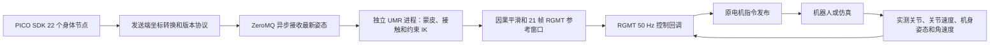

# PICO → UMR → RGMT 实时遥操

在 `model_config.py` 中选择 `RGMT_REFERENCE_MODE = "pico_umr"`（当前已设为此模式）。
使用现有仿真或实机 launch。launch 会启动 PICO 服务及匹配的发送器，发送器自动加
`--body-layout smpl22`。原 `pico` 模式仍走 neural_retarget；原 `umr` 模式仍播放文件。

```bash
source install/setup.bash
ros2 launch bxi_example_py_elf3 example_dance.launch.py
```

PICO 服务已经手动运行时，可将 `PICO_AUTO_START_SERVICE` 设为 `False` 复用它。
PICO 需要连接 Motion Tracker 并完成 SDK 的人体校准；只有控制器/头显数据时，
本链路不会生成全身动作。A 键仍负责进入原走路状态，X 键从走路切换到实时跟踪。
X 键再次按下暂停当前参考；恢复时重置人体/接触状态并从新数据重新进入跟踪。
Y 键沿用躺下/起身流程。

手动运行发送器时使用新的身体协议：

```bash
python3 -m bxi_example_py_elf3.pico_pose_sender \
  --endpoint 'tcp://*:28704' --fps 50 --body-layout smpl22
```

SDK 和服务仍使用包内 `third_party/pico` 的既有运行资源。默认 launch 会配置这些
路径，手动命令需要沿用该 SDK 的 PYTHONPATH/动态库路径。

## 数据和反馈

PICO SDK 的前 22 个身体节点按 SMPL 身体顺序传输：骨盆、左右腿、三段脊柱、脚部、
颈部、锁骨、头部及双臂。世界坐标从 SDK Y-up 转为 Z-up，骨骼局部轴转为既有 SMPL
契约；转换只在发送端做一次，UMR 不再叠加 BVH 或 GMR 的坐标偏移。
协议为 `elf3_smpl22_bodies_v1`，接收端严格校验节点名称、形状及有限值；旧 14 节点
发送器不能混入此模式。



首次有效姿态通过左右腿段长度估计人体尺度，使用已打包的 neutral SMPL-X 身体表面，
完整保留 22 个节点的实测位置和转动。蒙皮保留姿态修正，并以实测关节中心代替
neutral 骨架逐级 FK 推算的位置，减少脚部因腿长及骨架不一致产生的厘米级误差。
机器人表面对应关系、地面约束、关节限位沿用原 UMR。机器人测量进入 RGMT 反馈，不把测量轨迹当作
人体目标；UMR 负责运动学参考，RGMT 和现有 PD 控制负责跟踪。

实时路径使用独立求解进程，数值库单线程；输入、输出都只保留最新待处理数据，
不排队播放过时人体动作。PICO 接收和进程收发各由独立线程处理，控制回调不等待 IK。
模型和表面资源常驻内存，没有文件参考缓存，也没有离线动作缓冲储备。

实时接触由踝部和脚尖的高度、速度与迟滞判定。启动及恢复跟踪时应先双脚落地静站；
该姿态用于校准各脚标记点的地面高度，SDK 世界坐标零高度不能直接当作地面。
速度滤波时间常数为 50 ms，支撑进入/退出均需连续两个样本。两标记点共同抬高
超过 1.2 cm 且向上速度超过 0.06 m/s 时提前释放；高度超过 5 cm 或运动较快也释放。
单个踝/脚尖转动而另一个标记点仍停留在地面时，继续允许脚跟/脚尖支撑。
释放后记录摆脚的最高净高度；需接近地面或已下降至少 8 mm，且低于 2.5 cm、
运动较慢及不再明显上升，才重新进入支撑，避免低幅度抬脚停住后又被锁回地面。
支撑期保留同一组足底表面锚点，抬脚后释放。
地面高度只在双脚已经支撑、四个标记点一致且缓慢地上下偏移时修正共同漂移；
不会把单脚姿态变化或一次低点异常累计成永久的更低地面。
实时锚点行权重从 5 调为 15，降低标记点漂移与脚部表面跟随目标对支撑脚的拉动。
地面穿透约束始终保留；原始文件模式的接触判断和权重保持原配置。

在线输入看不到未来动作：参考窗口使用十个过去帧和当前帧，后十帧根据最新速度作
有限幅度的指数衰减外推。`model_config.py` 中 `PICO_UMR_PREDICTION_TIME_S = 0.08`
是 80 ms 衰减时间常数，不是等待时间；关节未来偏移最多 0.2 rad、机身旋转最多
0.1 rad，预测关节位置满足 MJCF 限位及 0.1 rad 膝关节下限。到达限位时对应未来速度
归零。首帧、暂停以及设置为 `0` 时保持当前姿态、未来速度归零。
可通过环境变量同名覆盖该配置，例如 `PICO_UMR_PREDICTION_TIME_S=0` 做保持模式对照。
外推不能替代真实未来动作，急停和反向仍有误差；不引入 200 ms 未来帧缓冲。
运动学参考使用约 35 ms 时间常数的因果滤波；日志中的数据年龄不包含滤波本身或
头显侧追踪延迟。

当前 RGMT 每帧命令是机身角速度 3 维、关节位置 29 维、关节速度 29 维。
人体根节点 XY 位移或线速度没有独立命令通道，因此人在场景内平移不等价于给策略
指定走路速度；步态仍依赖腿部参考与反馈。改变此契约需要配套模型训练和导出。

## 断流、暂停和恢复

- 重复、乱序数据不刷新接收时间，不伪造新的人体帧。
- UMR 参考超过 150 ms、PICO 断流超过 250 ms 或无有效身体数据时，返回“参考未就绪”，
  控制节点继续运行原 AMP 零速度平衡，并清除旧的动作过渡。
- 恢复时重置 UMR 暖启动和接触锚点、RGMT 历史与航向对齐。旧会话结果带有不同的
  epoch，会被丢弃；新的参考就绪后用原 0.6 秒混合进入跟踪。
- 暂停时保持参考姿态并将速度归零，仍执行 RGMT 反馈；恢复时采用新的会话。
- 节点退出会回收求解子进程和接收/收发线程。致命进程错误保留在日志中，不继续输出
  旧参考；需要修复错误并重启节点。

每五秒输出 `PICO UMR`，包含已求解帧数、求解能力、参考年龄和来源到求解完成的耗时，
以及 `backend=process`、`worker_pid`、`prediction_time_ms`。数据年龄从本机 PICO 接收时间算起，不能解释为
头显到电机的全部延迟。

## 软件验证

```bash
PYTHONPATH=src/bxi_example_py_elf3 python3 -m pytest -q \
  src/bxi_example_py_elf3/third_party/umr/tests src/bxi_example_py_elf3/test

python3 src/bxi_example_py_elf3/third_party/umr/tools/benchmark_live.py --ticks 500
```

第二个命令使用合成 SDK 格式人体动作，经真实 ZeroMQ、UMR 子进程和 RGMT，发送目标
给独立 MuJoCo 模型的 PD，再把关节测量反馈给下一次策略调用；不发布 ROS 电机命令。
根节点使用虚拟支撑，所以它验证软件数据和反馈闭环，不验证自由站立平衡。

当前机器 500 个 50 Hz 周期中，初始准备后无参考断档；参考年龄 P99 约 46 ms，
控制调用 P99 约 6 ms。协议、SMPL 蒙皮等价性、因果窗口、时序/断流、暂停、子进程
和 RGMT 测量反馈均有回归检查。实机动作仍需在实际佩戴、校准及机器人反馈条件下验证。

实际 ROS 控制节点使用同一合成 PICO 输入和 MuJoCo 关节测量回放 200 个周期；
初始化后 194 个周期处于跟踪状态，控制分支调用 P99 约 4.7 ms，并通过暂停零参考
速度及断流回到 AMP 的检查。该检查将电机发布替换为仿真 PD，未发送实机命令。
初始版本全套 30 项回归测试通过，原文件重定向和 neural14 PICO 路径也包含在检查内。

随后采集了 1474 帧实际 PICO 数据（29.46 秒、50.001 Hz）。用户确认约 16 秒之后
有弯腰/调整头显，因此自由站立仿真只使用前 16 秒，不能把后段前倾归因于追踪故障。
脚部位置、支撑锚点和有限外推修正后的验证记录及局限见
[DIAGNOSTICS_PICO.md](DIAGNOSTICS_PICO.md)。新增实测关节位置覆盖 FK、接触迟滞、
支撑锚点保持/释放、预测限位和暂停检查，初次修正全套 34 项测试通过。
随后针对用户来回走动的视频，补充小幅慢速抬脚、悬停不重锁、落脚重建接触、
脚尖支撑、单脚低点异常和真实 IK 锚点释放回归；当前全套 38 项测试通过。
